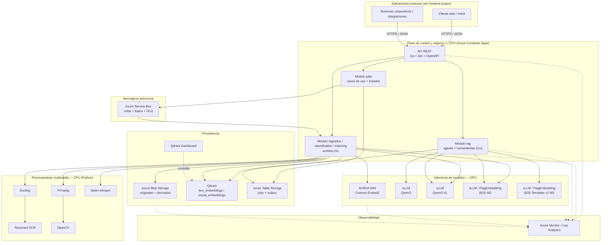
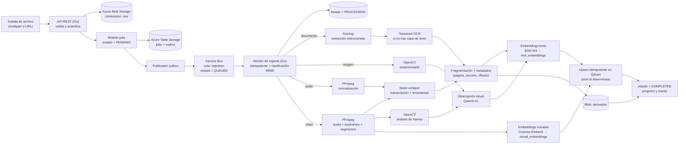
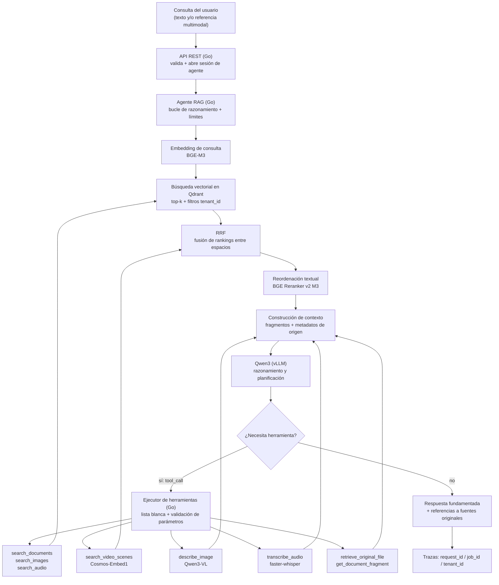
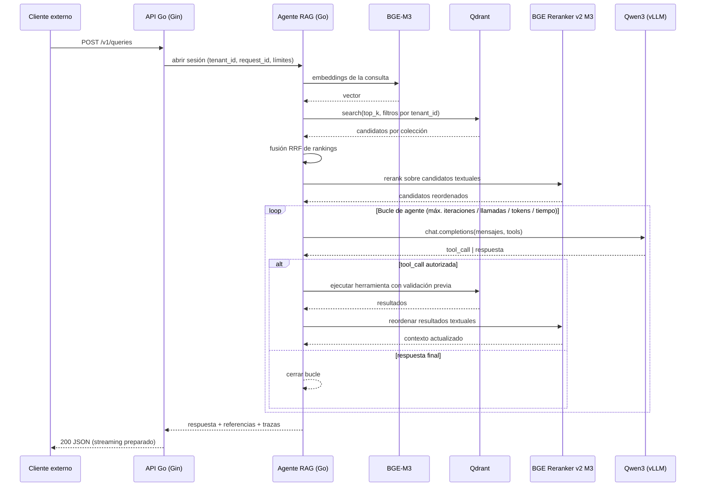
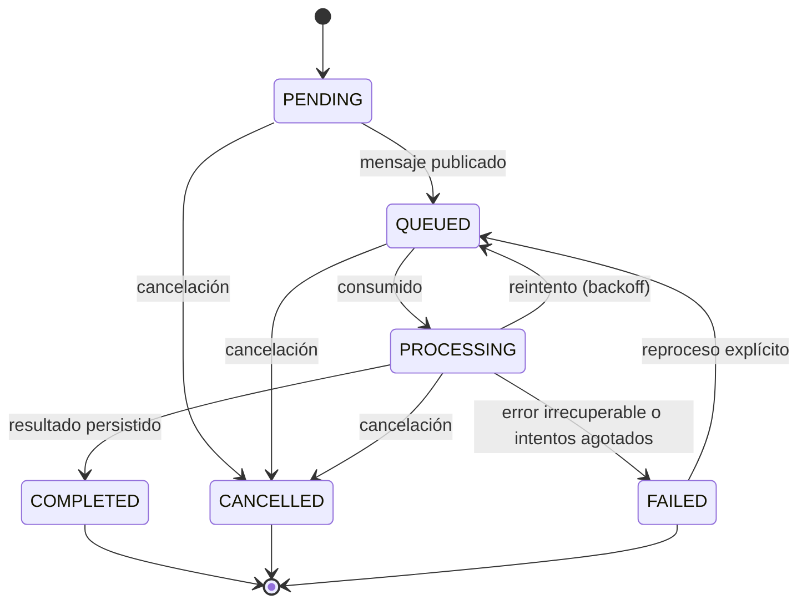

# MAR — Arquitectura tecnológica

> **Estado:** Revisión 2 — base para implementación
> **Alcance:** definición técnica, responsabilidades, límites modulares, comunicación, estructura del repositorio y entornos.
> **Seguridad:** documento diseñado siguiendo la documentación corporativa de **ENS Alta** (RD 311/2022). No se fija ningún mecanismo concreto de autenticación por defecto; se preparan puntos de extensión. **No se declara cumplimiento** hasta que las medidas estén implementadas y validadas.
> **Decisiones registradas:** `docs/adr/` · **Avance:** `docs/ROADMAP.md`

---

## Índice

1. [Resumen esquemático de la aplicación](#1-resumen-esquemático-de-la-aplicación)
2. [Tecnologías y responsabilidades](#2-tecnologías-y-responsabilidades)
3. [Arquitectura general (Mermaid)](#3-arquitectura-general-mermaid)
4. [Flujo de ingesta y procesamiento multimedia](#4-flujo-de-ingesta-y-procesamiento-multimedia)
5. [Flujo de consulta Agentic RAG](#5-flujo-de-consulta-agentic-rag)
6. [Estructura del repositorio (monorepo)](#6-estructura-del-repositorio-monorepo)
7. [Comunicación entre componentes](#7-comunicación-entre-componentes)
8. [Separación CPU / GPU](#8-separación-cpu--gpu)
9. [Entorno de desarrollo local y despliegue en Azure](#9-entorno-de-desarrollo-local-y-despliegue-en-azure)
10. [Principios arquitectónicos y evolución a microservicios](#10-principios-arquitectónicos-y-evolución-a-microservicios)
11. [Estrategia de almacenamiento vectorial (Qdrant)](#11-estrategia-de-almacenamiento-vectorial-qdrant)
12. [Gestión de trabajos y procesamiento asíncrono](#12-gestión-de-trabajos-y-procesamiento-asíncrono)
13. [Contratos de API iniciales](#13-contratos-de-api-iniciales)
14. [Validación de compatibilidad modelo ↔ motor](#14-validación-de-compatibilidad-modelo--motor)
15. [Seguridad y ENS Alta](#15-seguridad-y-ens-alta)
16. [Cuestiones abiertas](#16-cuestiones-abiertas)
17. [Referencias](#17-referencias)

---

## 1. Resumen esquemático de la aplicación

**MAR** es un motor backend de conocimiento multimodal. Procesa documentos, imágenes, audio y vídeo; extrae y clasifica información; genera embeddings; y responde consultas mediante **Agentic RAG**. No tiene frontend propio: toda su funcionalidad se expone como **API REST JSON** para aplicaciones externas.

Forma de despliegue inicial: **monolito modular en Go** + worker Python de procesamiento multimedia + servidores de inferencia independientes en GPU. Diseñado desde el primer día para **evolucionar a microservicios** sin reescribir la lógica de negocio.

| Plano | Contenido | Naturaleza |
|---|---|---|
| **Exposición** | API REST (Go + Gin), contrato OpenAPI | Síncrono, CPU |
| **Dominio y casos de uso** | Módulos `ingestion`, `jobs`, `classification`, `indexing`, `search`, `rag` | Síncrono + asíncrono, CPU |
| **Mensajería** | Azure Service Bus (colas y topics): transporte de mensajes, **no** fuente de verdad | Asíncrono |
| **Estado operativo** | Azure Table Storage: estados de trabajos y metadatos operativos | Almacenamiento |
| **Procesamiento multimedia** | Docling, Tesseract, FFmpeg, OpenCV, faster-whisper en un worker Python modular | Asíncrono, CPU |
| **Inferencia** | 6 modelos servidos por motores estándar (NVIDIA NIM, vLLM, CTranslate2) | Síncrono por HTTP o por cola, GPU |
| **Persistencia de contenido** | Azure Blob Storage (originales y derivados) y Qdrant (vectores y metadatos) | Almacenamiento |
| **Observabilidad** | Azure Monitor / Log Analytics + trazas correlacionadas | Transversal |

Flujo macro:

```
Subida ─▶ Blob ─▶ Job (Table Storage) ─▶ Service Bus ─▶ Worker multimedia (Python) + Modelos (GPU)
                                                              └─▶ Embeddings ─▶ Qdrant

Consulta ─▶ API Go ─▶ Agente RAG (Go) ─▶ Qdrant ─▶ RRF ─▶ Reranker ─▶ Qwen3 (tools) ─▶ Respuesta + fuentes
```

---

## 2. Tecnologías y responsabilidades

Versiones verificadas en el momento de redactar este documento contra los repositorios públicos de cada dependencia (no se fijan versiones inventadas; las versiones concretas se confirman al instalar y quedan registradas en `go.mod` / `pyproject.toml`).

| Tecnología | Componente / capa | Responsabilidad | Versión de referencia |
|---|---|---|---|
| **Go** | Lenguaje del backend | Lógica de negocio, orquestación, concurrencia de jobs y agente RAG | 1.27.4 (instalada) |
| **Gin** | Framework HTTP | Enrutado REST, middleware, validación de payloads, respuestas JSON | v1.12.0 |
| **`log/slog`** | Logging | Logging estructurado JSON nativo, sin dependencias externas | stdlib |
| **OpenAPI / Swagger** | Contrato y documentación | Contrato público de la API, generación de clientes y UI de pruebas | OpenAPI 3 |
| **Qdrant** | Base de datos vectorial | Embeddings, metadatos, filtrado por `tenant_id`, búsqueda semántica (densa, dispersa, multivector) | servidor 1.20.x |
| **Qdrant Go Client** | Adaptador de persistencia | Comunicación Go ↔ Qdrant (gRPC) | v1.20.2 |
| **Qdrant Dashboard** | Administración | Inspección de colecciones, puntos y filtros | incluido en la imagen |
| **Azure Blob Storage** | Almacenamiento de objetos | Originales y derivados (texto, JSON, frames, transcripciones, miniaturas) | `azblob` v1.8.3 |
| **Azure Table Storage** | Estado operativo (propuesta inicial) | Estados y metadatos de trabajos, idempotencia, outbox de publicación | `aztables` v1.4.1 |
| **Azure Service Bus** | Mensajería | Colas y topics: transporte, reintentos, DLQ. **No es fuente de verdad** | `azservicebus` v1.11.0 |
| **Azure Identity** | Autenticación de servicios | Identidad gestionada y credenciales por entorno | `azidentity` v1.15.0 |
| **Azure Container Registry** | Registro de imágenes | Distribución de imágenes Docker del backend, workers e inferencia | gestionado |
| **Azure Container Apps** | Ejecución | Backend, workers y media worker; escalado por eventos y a cero | gestionado |
| **Azure GPU VM / AKS** | Ejecución GPU | Servidores de inferencia (vLLM, NIM, faster-whisper) | dimensionamiento pendiente |
| **Azure Monitor / Log Analytics** | Observabilidad | Métricas, logs, trazas, alertas | gestionado |
| **Docker** | Contenerización | Empaquetado de todos los componentes | 29.10.0 (instalada) |
| **Docker Compose** | Desarrollo local | Orquestación del entorno de desarrollo | v5.7.0 (instalada) |
| **Azurite** | Emulación local | Emula Azure Blob Storage y Azure Table Storage | imagen oficial |
| **Python** | Componentes especializados | Procesamiento multimedia desacoplado (un worker modular, no un microservicio por herramienta) | 3.12 (instalada) |
| **Docling** | Extracción de documentos | Conversión y estructuración de PDF/Office/HTML a Markdown/JSON | por confirmar al instalar |
| **Tesseract OCR** | Reconocimiento óptico | Texto de escaneos e imágenes sin capa de texto | por confirmar al instalar |
| **FFmpeg** | Vídeo / audio | Extracción de audio, keyframes y segmentación temporal | por confirmar al instalar |
| **OpenCV** | Visión por computador | Preprocesado de imagen y análisis de frames | por confirmar al instalar |
| **Cosmos-Embed1** | Modelo (NVIDIA NIM) | Embeddings visuales vídeo-texto; búsqueda de escenas | ver §14 |
| **Faster-Whisper** | Modelo (Python + CTranslate2) | Transcripción con timestamps sincronizados | ver §14 |
| **BGE-M3** | Modelo (FlagEmbedding / vLLM) | Embeddings textuales (denso, disperso, multivector) | ver §14 |
| **Qwen3-VL** | Modelo (vLLM) | Comprensión visual: objetos, acciones, evidencias | ver §14 |
| **Qwen3** | Modelo (vLLM) | Razonamiento, Agentic RAG, planificación de herramientas, respuestas | ver §14 |
| **BGE Reranker v2 M3** | Modelo (FlagEmbedding / vLLM) | Reordenación de resultados textuales | ver §14 |

Criterio de dependencias: se prefieren **stdlib y SDK oficiales de Azure**. No se incorporan frameworks adicionales sin justificación técnica registrada en un ADR.

---

## 3. Arquitectura general (Mermaid)



> En la implementación inicial **todos los módulos Go se ejecutan en el mismo binario** (`cmd/api`) y los consumidores en `cmd/worker`. El diagrama refleja límites lógicos, no despliegues separados.

---

## 4. Flujo de ingesta y procesamiento multimedia



| # | Etapa | Ejecuta | Salida |
|---|---|---|---|
| 1 | Recepción y validación | API Go (módulo `ingestion`) | Original en Blob + job `PENDING` |
| 2 | Encolado fiable | Módulo `jobs` (outbox → Service Bus) | Mensaje `IngestJobMessage` v1, job `QUEUED` |
| 3 | Consumo idempotente y clasificación | Worker Go (`classification`) | Tipo de pipeline y job `PROCESSING` |
| 4 | Extracción | Worker Python | Texto, estructura, frames, audio normalizado |
| 5 | Enriquecimiento con modelos | GPU | Transcripciones, descripciones visuales, embeddings |
| 6 | Fragmentación y embeddings de texto | Go + BGE-M3 | Fragmentos con metadatos y vectores |
| 7 | Indexado | Go (`indexing`) + Qdrant | Puntos con payload de trazabilidad |
| 8 | Derivados y cierre | Go → Blob + Table Storage | Job `COMPLETED` y progreso actualizado |

Los fallos irrecuperables marcan el job como `FAILED` con el error persistido; los recuperables se reintentan con backoff y, agotados los intentos, van a la **DLQ** dejando el job en `FAILED`.

---

## 5. Flujo de consulta Agentic RAG

### 5.1 Diagrama de flujo



Herramientas iniciales (registro cerrado y ampliable por configuración):

| Herramienta | Propósito |
|---|---|
| `search_documents` | Recuperación textual en `text_embeddings` (BGE-M3) |
| `search_images` | Recuperación de descripciones y metadatos de imágenes |
| `search_audio` | Recuperación de transcripciones y fragmentos de audio |
| `search_video_scenes` | Recuperación de escenas en `visual_embeddings` (Cosmos-Embed1) |
| `describe_image` | Descripción bajo demanda con Qwen3-VL |
| `transcribe_audio` | Transcripción bajo demanda con faster-whisper |
| `retrieve_original_file` | Referencia firmada al original en Blob |
| `get_document_fragment` | Fragmento concreto con contexto y offsets |

### 5.2 Secuencia



**Reparto de responsabilidades del agente**

- **Qwen3** razona, planifica y **selecciona** herramientas. No ejecuta nada.
- **Go** valida parámetros, autoriza, ejecuta y limita (iteraciones, llamadas, tokens, tiempo).
- **BGE Reranker v2 M3** reordena únicamente contenido **textual**; no se aplica a vectores visuales.
- El agente **no** ejecuta código, comandos, SQL ni consultas arbitrarias.
- La arquitectura se prepara para **respuestas en streaming** (paso 1: respuesta completa; paso 2: canal de streaming), sin comprometer el contrato actual.

---

## 6. Estructura del repositorio (monorepo)

Adaptación de la estructura propuesta al contenido ya existente. **El módulo Go permanece en la raíz**: el repositorio `mar-backend` *es* el módulo Go (`module mar-backend`, `go.mod` en la raíz) y moverlo a `backend/` obligaría a un renombrado de módulo sin beneficio funcional. Decisión registrada en `docs/adr/0005-estructura-monorepo.md`.

```text
mar-backend/                      # raíz del monorepo
├── cmd/
│   ├── api/                      # binario del servidor HTTP
│   └── worker/                   # binario de consumidores de Azure Service Bus
├── internal/
│   ├── platform/                 # transversal, SIN lógica de negocio
│   │   ├── config/               # carga y validación de configuración
│   │   ├── logging/              # slog + campos de correlación
│   │   ├── ids/                  # generación de identificadores únicos
│   │   ├── apierr/               # taxonomía de errores y mapeo HTTP
│   │   ├── httpapi/              # servidor, middleware, respuestas, router
│   │   └── health/               # liveness / readiness con registro de checks
│   ├── jobs/                     # módulo: dominio + casos de uso + puertos + adaptadores propios
│   ├── ingestion/                # módulo: recursos, subida y encolado
│   ├── classification/           # módulo: clasificación y enrutado de contenido
│   ├── indexing/                 # módulo: fragmentación e indexado de embeddings
│   ├── search/                   # módulo: recuperación y fusión de rankings (RRF)
│   ├── rag/                      # módulo: agente, límites, herramientas autorizadas
│   ├── inference/                # adaptadores a motores de inferencia (+ mocks de desarrollo)
│   └── storage/                  # adaptadores de almacenamiento que implementan puertos
│       ├── blob/                 # Azure Blob Storage
│       ├── table/                # Azure Table Storage
│       └── qdrant/               # Qdrant (colecciones, upsert, búsqueda)
├── contracts/
│   ├── openapi/                  # contrato público (fuente de verdad)
│   └── events/                   # esquemas JSON de mensajes internos versionados
├── workers/
│   └── media/                    # worker Python modular (documents / images / audio / video)
│       ├── src/
│       ├── tests/
│       ├── pyproject.toml
│       └── Dockerfile
├── inference/                    # configuración de despliegue de motores (no código propio)
│   ├── vllm/
│   ├── nim/
│   ├── whisper/
│   └── flagembedding/
├── deploy/
│   ├── docker/                   # Dockerfiles de cada binario
│   ├── compose/                  # recursos auxiliares del entorno local
│   └── azure/                    # IaC y definiciones de despliegue
├── tests/                        # pruebas de integración y fixtures compartidos
├── scripts/                      # utilidades de desarrollo y operación
├── docs/
│   ├── ARCHITECTURE.md
│   ├── ROADMAP.md
│   └── adr/
├── compose.yaml
├── .env.example
├── .gitignore
├── README.md
├── go.mod
└── go.sum
```

**Estructura interna de un módulo Go**

Cada módulo es dueño de sus datos y expone una única superficie pública. Se evita crear subcarpetas vacías: los subpaquetes aparecen solo cuando contienen código real.

```text
internal/jobs/
├── job.go          # entidad + estados + reglas de transición (dominio puro)
├── repository.go   # puerto de persistencia (interfaz)
├── service.go      # casos de uso
├── memory.go       # adaptador en memoria (desarrollo y pruebas)
└── table.go        # adaptador Azure Table Storage
```

Reglas de dependencia:

- `cmd/*` → módulos → `platform`.
- Un módulo **no** accede a los repositorios internos de otro módulo: la comunicación se hace por interfaces públicas del módulo o por eventos.
- `platform` no importa ningún módulo de negocio.
- Los adaptadores (`storage/`, `inference/`) implementan puertos definidos por los módulos (inversión de dependencias).
- Prohibidas las dependencias circulares; se comprueba en CI.

---

## 7. Comunicación entre componentes

### 7.1 Matriz de interfaces

| Origen | Destino | Modo | Protocolo | Contrato |
|---|---|---|---|---|
| Aplicación externa | API Go | Síncrono | HTTPS / REST JSON | OpenAPI 3 (`/v1/...`) |
| Módulo `ingestion` | Azure Blob Storage | Síncrono | HTTPS (`azblob`) | Contenedores `raw`, `derived`, `frames`, `transcripts` |
| Módulo `jobs` | Azure Table Storage | Síncrono | HTTPS (`aztables`) | Entidades `job` y `outbox` con ETag |
| Módulo `jobs` | Service Bus | Asíncrono (outbox + relay) | AMQP (`azservicebus`) | `IngestJobMessage` v1 |
| Worker Go | Worker multimedia Python | Asíncrono o síncrono | Service Bus / HTTP interno | `ProcessRequest` / `ProcessResult` v1 |
| Worker Go / Agente Go | Motores de inferencia (GPU) | Síncrono | HTTP REST | API compatible con OpenAI (chat, embeddings, score, transcripción) |
| Módulo `indexing` / `search` | Qdrant | Síncrono | gRPC (`qdrant/go-client`) | Colecciones + payload versionado |
| Todos | Azure Monitor | Asíncrono | logs estructurados + OTLP | JSON con `request_id`, `job_id`, `tenant_id` |

### 7.2 Criterio de síncrono frente a asíncrono

- **Síncrono (HTTP):** baja latencia y respuesta inmediata — consultas del agente, embeddings de una consulta, descripción puntual de imagen.
- **Asíncrono (Service Bus):** operaciones pesadas y de duración variable — ingesta, transcripción, extracción de frames, indexado masivo. El cliente recibe un `job_id` y consulta estado o recibe notificación.

### 7.3 Contratos y garantías

| Aspecto | Decisión |
|---|---|
| Contrato público | OpenAPI 3 como fuente de verdad; versión en la ruta (`/v1`) |
| Contrato interno | Esquemas JSON explícitos en `contracts/events/` con campo `schema_version` |
| Identificadores | `resource_id`, `job_id`, `fragment_id`, `request_id` generados por el backend |
| Idempotencia | Consumidores idempotentes; `point_id` determinista en Qdrant; clave de idempotencia por mensaje |
| Entrega | Al menos una vez: **se asume reentrega** y se tolera duplicación |
| Reintentos | Backoff exponencial acotado + `maxDeliveryCount` + DLQ |
| Publicación fiable | Patrón **outbox** en Table Storage + relay de publicación (ver §12) |
| Concurrencia | Actualizaciones condicionales por **ETag** |
| Correlación | Propagación obligatoria de `request_id`, `job_id` y `tenant_id` |
| Multi-tenant | `tenant_id` obligatorio en Blob, Table Storage, Qdrant y mensajes |
| Sustitución de modelos | Interfaces Go (`Embedder`, `Transcriber`, `VisionModel`, `ChatModel`, `Reranker`); el motor es un detalle del adaptador |
| Fallo de inferencia | Timeouts, reintentos acotados, circuit breaker por modelo y degradación explícita (p. ej., respuesta sin rerank) |

### 7.4 Endpoints de inferencia esperados

| Modelo | Endpoint | Formato |
|---|---|---|
| Qwen3 | `POST /v1/chat/completions` con `tools` | OpenAI-compatible (`tool_calls`) |
| Qwen3-VL | `POST /v1/chat/completions` con contenido multimodal | OpenAI-compatible |
| BGE-M3 | `POST /v1/embeddings` | OpenAI-compatible |
| BGE Reranker v2 M3 | `POST /v1/score` o `/rerank` | Cross-encoder query/documento |
| Cosmos-Embed1 (NIM) | `POST /v1/embeddings` con `request_type` | `query` / `bulk_text` / `bulk_video` |
| Faster-Whisper | `POST /v1/audio/transcriptions` | Transcripción con timestamps |

Los adaptadores se configuran por **nombre lógico** (`MAR_MODEL_QWEN3_URL`), de modo que cambiar de motor no afecta a la lógica de negocio.

---

## 8. Separación CPU / GPU

| Componente | CPU | GPU | Justificación |
|---|---|---|---|
| API REST (Go + Gin) | ✅ | — | I/O y validación |
| Módulos `jobs`, `ingestion`, `classification`, `indexing`, `search`, `rag` | ✅ | — | Orquestación, reglas y recuperación |
| Azure Blob / Table / Service Bus / ACR / Monitor | ✅ (gestionado) | — | Servicios gestionados |
| Qdrant | ✅ | Opcional | Indexado y búsqueda en CPU; GPU solo si el volumen lo justifica |
| Docling, Tesseract, FFmpeg, OpenCV | ✅ | — | Procesamiento determinista |
| **BGE-M3** | — | ✅ | Cómputo tensorial intensivo y alto volumen |
| **BGE Reranker v2 M3** | Admite CPU | ✅ (recomendado) | 0,6 B de parámetros; viable en CPU a baja carga |
| **Qwen3** | — | ✅ | Inferencia LLM |
| **Qwen3-VL** | — | ✅ | Inferencia multimodal |
| **Cosmos-Embed1** (NIM) | — | ✅ | Requiere GPU NVIDIA (≈40 GB+ recomendado) |
| **Faster-Whisper** | Admite CPU | ✅ (recomendado) | GPU para lotes; CPU como modo degradado |

Consecuencias de diseño:

- **Dos planos de escalado independientes:** el plano CPU escala por profundidad de cola y latencia HTTP; el plano GPU, por utilización y cola de inferencia.
- Los modelos escalan por **carga real de inferencia** (agrupación de lotes), no por número de peticiones HTTP del cliente.
- **Degradación controlada:** con el plano GPU saturado, la ingesta sigue aceptándose (los jobs esperan en cola) y las consultas pueden servirse sin rerank o con `top-k` reducido.

---

## 9. Entorno de desarrollo local y despliegue en Azure

### 9.1 Desarrollo local

Objetivo: reproducir el sistema sin GPU y sin contratar recursos Azure, con sustitutos locales y mocks explícitos.

| Necesidad | Sustituto local |
|---|---|
| Qdrant | Contenedor oficial Qdrant 1.20.x + Dashboard |
| Azure Blob Storage | **Azurite** (emulador de Blob) |
| Azure Table Storage | **Azurite** (emulador de Table) |
| Azure Service Bus | Emulador de Service Bus; si no cubre el escenario, instancia remota de desarrollo |
| Azure Container Registry | No aplica en local |
| Monitores | Logs estructurados a stdout |
| Inferencia GPU | Endpoint externo configurable **o** adaptadores mock de desarrollo |

Composición prevista en `compose.yaml` (raíz del monorepo). Implementado en la
Fase 2 (perfil `app` para el backend Go):

```text
servicios: qdrant, azurite, api (backend Go, perfil `app`)
pendientes:   servicebus, worker, media (Fases 3–4)
inferencia: por URL externa o mocks; nunca se activan mocks en producción
```

Notas de implementación local:

- **Red interna `mar`**: dentro de Compose los servicios se direccionan por
  nombre de servicio (`http://qdrant:6334`, `http://azurite:10000/...`), nunca
  por `localhost`.
- **Health checks** de contenedor para Qdrant, Azurite y el backend (mediante
  `bash`/`node`/`wget`, presentes en cada imagen); `api` espera a que Qdrant y
  Azurite estén sanos.
- **Azurite** se ejecuta con `--skipApiVersionCheck`: el SDK de Azure para Go
  envía una versión de API (`x-ms-version`) más reciente que la reconocida por
  la imagen del emulador. Solo afecta al entorno local.

Reglas del entorno local:

- **Mocks de inferencia** identificados explícitamente y activables solo con configuración explícita de desarrollo; el binario **rechaza** los mocks si el entorno es `production`.
- Los DTO se validan contra `contracts/openapi` y `contracts/events`.
- La diferencia de versión menor entre el cliente Qdrant y el servidor no debe superar 1.
- No se descargan pesos de modelos ni se provisiona infraestructura Azure en esta fase.

### 9.2 Despliegue en Azure

| Recurso | Uso en MAR | Notas de diseño |
|---|---|---|
| Resource Group por entorno | Contenedor lógico | `dev` / `staging` / `prod` separados |
| Azure Container Registry | Imágenes de `mar-api`, `mar-worker`, `mar-media`, motores | Etiquetas inmutables por commit; escaneo de vulnerabilidades |
| Container Apps Environment (CPU) | API, workers Go, media worker | Escalado por eventos (KEDA) y a cero; `minReplicas` para la API |
| Container Apps (GPU serverless) | Cargas GPU puntuales o de ráfaga | Sin gestión de nodos |
| AKS (pools GPU) | Inferencia con GPU persistente (vLLM, NIM) | Autoscaling de nodos GPU |
| Azure GPU VM | Alternativa aislada para modelos concretos | Dimensionamiento pendiente |
| Azure Blob Storage | `raw`, `derived`, `frames`, `transcripts` | Ciclo de vida y cifrado en reposo |
| Azure Table Storage | `resources`, `jobs` (`outbox` en Fase 3) | `PartitionKey = tenant_id`, `RowKey = resource_id`/`job_id`; escalado por partición |
| Azure Service Bus | Colas `ingestion`, `embedding`, `indexing`; topic de notificaciones | DLQ + reintentos; alertas por profundidad |
| Qdrant | Servicio vectorial sobre AKS con disco persistente o servicio gestionado | Dashboard solo en red interna |
| Azure Monitor + Log Analytics | Métricas, trazas y alertas | Alertas: profundidad de cola, p95, uso de GPU, tasa de error |
| Key Vault | Secretos y claves | Acceso por identidad gestionada |
| Virtual Network + Private Endpoints | Aislamiento de Blob, Table, Service Bus, Qdrant y ACR | **Inferencia nunca expuesta públicamente** |

Flujo de despliegue:

```
Commit ─▶ CI (gofmt + go vet + tests + validación de contratos) ─▶ build imágenes ─▶ push a ACR
        ─▶ CD (IaC) ─▶ Container Apps (CPU) + AKS/GPU (inferencia)
        ─▶ verificación post-despliegue (health, humo de ingesta y consulta)
```

---

## 10. Principios arquitectónicos y evolución a microservicios

### 10.1 Estilo arquitectónico

| Principio | Aplicación concreta |
|---|---|
| Arquitectura hexagonal (Ports & Adapters) | El dominio define puertos; `storage/`, `inference/` y la capa HTTP aportan adaptadores |
| DDD pragmático | Un módulo por contexto delimitado, con su lenguaje y sus reglas; sin ceremonia innecesaria |
| Inversión de dependencias | Los módulos dependen de interfaces, nunca de SDK de Azure, Qdrant o motores concretos |
| Capas | Dominio → casos de uso → infraestructura → exposición, con dependencias hacia dentro |
| Arquitectura orientada a eventos | Ingesta y procesamiento se comunican por eventos de Service Bus |
| Contratos versionados | Internos (`contracts/events`) y externos (`contracts/openapi`) con `schema_version` |
| Bajo acoplamiento / alta cohesión | Un módulo = una responsabilidad; comunicación por interfaces o eventos |
| Escalado independiente CPU/GPU | Ver §8 |
| Sin ciclos ni accesos cruzados | Prohibido importar repositorios internos de otro módulo |
| Sin sobreingeniería | No se crean interfaces, capas o carpetas sin responsabilidad real y actual |

### 10.2 Comunicación entre módulos hoy y mañana

Hoy: interfaces Go internas en el mismo proceso. Mañana: los mismos puertos se implementan con **adaptadores REST, gRPC o eventos de Service Bus** sin tocar los casos de uso. Es decir, cambiar el transporte no cambia la lógica de negocio.

### 10.3 Futuros microservicios y criterio de extracción

| Servicio | Lenguaje | Responsabilidad | Módulo de origen |
|---|---|---|---|
| API Gateway | Go o servicio gestionado Azure | Punto de entrada de MAR | — |
| Ingestion Service | Go | Recepción y gestión de archivos | `internal/ingestion` |
| Job Service | Go | Trabajos, estados y reintentos | `internal/jobs` |
| Classification Service | Go | Clasificación y enrutado | `internal/classification` |
| Indexing Service | Go | Indexación y embeddings | `internal/indexing` |
| Search Service | Go | Búsquedas semánticas y recuperación | `internal/search` |
| Agentic RAG Service | Go | Agentes, herramientas y respuestas | `internal/rag` |
| Document Service | Python | Procesamiento de documentos | `workers/media` (pipeline `documents`) |
| Image Service | Python | Procesamiento de imágenes | `workers/media` (pipeline `images`) |
| Audio Service | Python | Procesamiento de audio | `workers/media` (pipeline `audio`) |
| Video Service | Python | Procesamiento de vídeo | `workers/media` (pipeline `video`) |

**No se crean ahora.** Se implementan como módulos y se extraen solo cuando exista una necesidad real de escalado, aislamiento o despliegue independiente. La extracción se justifica cuando: el módulo tiene un perfil de recursos claramente distinto, cambia con cadencia propia, requiere aislamiento de seguridad o necesita escalar por separado.

En la arquitectura distribuida, **cada servicio posee sus datos y expone contratos**; se prohíben los accesos directos a los almacenes privados de otro servicio.

---

## 11. Estrategia de almacenamiento vectorial (Qdrant)

### 11.1 Colecciones

| Colección | Modelo | Contenido |
|---|---|---|
| `text_embeddings` | BGE-M3 | Documentos, transcripciones de audio y descripciones visuales generadas por Qwen3-VL |
| `visual_embeddings` | Cosmos-Embed1 | Escenas y fragmentos visuales de vídeo |

Separar por modelo es **obligatorio**: nunca se comparan vectores generados por modelos distintos, porque sus espacios no son comparables.

### 11.2 Vectores nombrados

`text_embeddings` puede contener **vectores nombrados** para representar las distintas salidas de BGE-M3:

| Nombre | Tipo | Uso |
|---|---|---|
| `dense` | denso | Recuperación semántica principal |
| `sparse` | disperso | Recuperación léxica (coincidencia de términos) |
| `colbert` | multivector | Reordenación fina por interacción tardía |

**Condición de motor:** no todos los motores exponen las mismas salidas. FlagEmbedding permite obtener denso, disperso y multivector; vLLM expone recuperación densa (API OpenAI de embeddings). Por tanto, la disponibilidad real de cada vector nombrado se determina **al desplegar el motor elegido** y se refleja en la configuración de la colección. No se asume equivalencia entre motores.

La dimensión densa de BGE-M3 (1024) y la de Cosmos-Embed1 se confirman al desplegar cada contenedor; se registran en la configuración y se validan contra la colección existente al arrancar.

### 11.3 Metadatos obligatorios por punto

| Campo | Descripción |
|---|---|
| `resource_id` | Identificador del recurso original |
| `fragment_id` | Identificador del fragmento (determinista) |
| `tenant_id` | Identificador del tenant (filtro obligatorio) |
| `content_type` | Tipo de contenido: documento, imagen, audio, vídeo, transcripción, descripción visual |
| `source_uri` | Referencia al archivo original en Blob |
| `page` / `section` | Página o sección, cuando corresponda |
| `start_ms` / `end_ms` | Timestamp inicial y final, cuando corresponda |
| `model_id` / `model_revision` | Modelo y revisión usados para generar el vector |
| `processed_at` | Fecha de procesamiento |
| `derived_uri` | Referencia a los derivados almacenados en Blob |

Se crean **índices de payload** al menos sobre `tenant_id`, `resource_id` y `content_type`, ya que son filtros constantes.

### 11.4 Reglas de integración

- `point_id` **determinista** (derivado de `resource_id` + `fragment_id` + `model_id`), lo que hace el upsert idempotente ante reentregas.
- Las **descripciones visuales de Qwen3-VL** se indexan como texto con BGE-M3 en `text_embeddings`, manteniendo el vínculo con el frame de origen.
- Los **fragmentos visuales originales** se procesan con Cosmos-Embed1 según los formatos soportados por el modelo.
- La combinación de resultados de espacios distintos se hace por **fusión de rankings (RRF)**, nunca comparando puntuaciones directas.
- El **reranker textual** actúa solo sobre contenido textual.

---

## 12. Gestión de trabajos y procesamiento asíncrono

### 12.1 Reparto de responsabilidades

- **Azure Table Storage**: fuente de verdad del estado y de los metadatos operativos del trabajo.
- **Azure Service Bus**: transporte de mensajes. **No** es fuente de verdad del estado.
- **Qdrant**: índice vectorial. **No** se usa como base de datos transaccional de trabajos.

Claves de diseño de la entidad: `PartitionKey = tenant_id`, `RowKey = job_id`. Esto agrupa los trabajos de un tenant en la misma partición, lo que permite **operaciones de lote transaccionales dentro de la partición** (necesario para el patrón outbox).

### 12.2 Estados y transiciones



Estados: `PENDING`, `QUEUED`, `PROCESSING`, `COMPLETED`, `FAILED`, `CANCELLED`. Las transiciones no listadas se rechazan en el dominio.

### 12.3 Mecanismos a implementar de forma progresiva

| Mecanismo | Enfoque |
|---|---|
| Persistencia de estados | Entidad `job` en Table Storage con `progress`, `stage`, `attempts`, `last_error` |
| Identificadores únicos | `job_id` generado por el backend; `point_id` determinista |
| Idempotencia | Clave de idempotencia por mensaje + upsert determinista en Qdrant |
| Reintentos | Backoff exponencial acotado; contador `attempts` persistido |
| DLQ | Cola de mensajes muertos con el motivo y el `job_id` para reproceso |
| Recuperación ante fallos | Barrido de reconciliación que detecta jobs en `PROCESSING` sin progreso |
| Control de concurrencia | Actualizaciones condicionales por **ETag**; conflicto → reintento |
| Cancelación | `POST /v1/jobs/{id}/cancel`; el worker comprueba el estado antes de cada etapa |
| Progreso | Actualización de `stage` y `progress` por etapa, con marca temporal |
| Reconciliación | Comparación periódica entre estado persistido y mensajes publicados |
| Publicación fiable | **Outbox** (ver 12.4) |

En la fase 3, `COMPLETED` indica que el worker verificó el tamaño y el SHA-256
del original y clasificó su tipo de pipeline. El recurso sigue en `STORED`.
El reintento conserva el estado `PROCESSING` y registra la etapa
`retry_scheduled`. El relay recupera intentos interrumpidos cuando caduca la
reserva del worker y vuelve a publicar entregas antiguas sin consumir. La extracción y el indexado se incorporan en fases
posteriores.

### 12.4 Publicación fiable (outbox)

Azure Table Storage no ofrece transacciones entre particiones, pero **sí** permite operaciones de lote atómico dentro de una misma partición. Como `PartitionKey = tenant_id`:

1. Se escribe el job (`QUEUED`) y, en el **mismo lote transaccional de la partición**, una entrada en `outbox`.
2. Un **relay de publicación** lee `outbox`, publica en Service Bus y marca la entrada como enviada (con ETag).
3. Si la publicación falla, la entrada permanece y se reintenta: **al menos una vez**, con consumidores idempotentes.

Esto garantiza que no se pierde un mensaje cuando la escritura del job ha tenido éxito, y que no se publica un mensaje de un job inexistente.

---

## 13. Contratos de API iniciales

Endpoints previstos, con su estado real en la implementación. **Los endpoints no implementados responden `501 Not Implemented` con un cuerpo de error explícito: nunca se devuelven datos ficticios.**

| Método | Ruta | Propósito | Estado |
|---|---|---|---|
| `GET` | `/health/live` | Sonda de vida del proceso | Implementado |
| `GET` | `/health/ready` | Sonda de disponibilidad con checks registrados | Implementado |
| `POST` | `/v1/resources` | Subida de un recurso y creación del trabajo | Implementado |
| `GET` | `/v1/resources/{id}` | Consulta de metadatos de un recurso | Implementado |
| `GET` | `/v1/jobs/{id}` | Estado, progreso y errores de un trabajo | Implementado |
| `POST` | `/v1/jobs/{id}/cancel` | Cancelación de un trabajo | Implementado |
| `POST` | `/v1/search` | Búsqueda semántica directa (sin agente) | Fase 4 |
| `POST` | `/v1/queries` | Consulta con Agentic RAG | Fase 5 |

Convenciones transversales: JSON, `X-Request-ID` de entrada y salida, `tenant_id` obligatorio, errores con el mismo esquema (`code`, `message`, `details`, `request_id`), límites de tamaño de petición y de cuerpo, timeouts explícitos.

---

## 14. Validación de compatibilidad modelo ↔ motor

Validación realizada contra la documentación oficial de cada motor. Las **versiones concretas** de pesos y motores se fijan y verifican al desplegar, y quedan registradas en `docs/ROADMAP.md`.

| Modelo | Motor propuesto | Compatibilidad | Observaciones verificadas |
|---|---|---|---|
| **Cosmos-Embed1** | NVIDIA NIM | ✅ Confirmada | NIM específico (`nvidia/cosmos-embed1`); HTTP/REST compatible con Embeddings de OpenAI; `request_type` = `query`/`bulk_text`/`bulk_video` (hasta 64 ítems por petición en vídeo); requiere GPU NVIDIA (A100/H100/L40S/L4/H20/L20); ~40 GB de VRAM recomendado |
| **Faster-Whisper** | Python + CTranslate2 | ✅ Confirmada | Reimplementación de Whisper sobre CTranslate2; carga por tamaño (`large-v3`, `distil-large-v3`); convierte modelos Whisper propios. **No expone API REST por sí sola** → se integra mediante worker Python o servidor de transcripción compatible (ver `inference/whisper/`) |
| **BGE-M3** | FlagEmbedding / vLLM | ✅ Confirmada con matices | FlagEmbedding expone denso, disperso y multivector; vLLM lo soporta como modelo de *pooling* con `--task embed` (recuperación densa). **Las capacidades no son equivalentes entre motores** (ver §11.2) |
| **Qwen3-VL** | vLLM | ✅ Confirmada | Soportado (`vllm serve Qwen/Qwen3-VL-8B-Instruct`, también 32B); requiere `--max_model_len` ajustado al presupuesto de VRAM |
| **Qwen3** | vLLM | ✅ Confirmada | Soportado (`vllm serve Qwen/Qwen3-32B`, `--tensor-parallel-size`); variantes MoE y cuantizadas FP8 validadas. Qwen3-32B en BF16 ≈ 73 GB → GPU de 80 GB o tensor-parallel |
| **BGE Reranker v2 M3** | FlagEmbedding / vLLM | ✅ Confirmada | Cross-encoder XLM-RoBERTa, 0,6 B, Apache-2.0; FlagEmbedding con `FlagReranker`; vLLM con tarea `score`. Viable en CPU a baja carga |

**Conclusiones**

- Los seis motores cubren los seis modelos: **no se desarrollan servidores Python de inferencia propios**.
- **Excepción acotada:** faster-whisper se integra como contenedor/worker de inferencia porque la librería no expone API REST.
- vLLM es motor común de tres modelos (Qwen3, Qwen3-VL, BGE-M3) y candidato para el cuarto (reranker), lo que reduce la superficie operativa.
- Los modelos se mantienen **desacoplados de la lógica de negocio** mediante adaptadores e interfaces.
- **Compatibilidad Qdrant:** mantener el cliente a una versión menor o igual que el servidor (`go-client v1.20.2` ↔ Qdrant 1.20.x).
- Pendiente: validar **licencias**, endpoints, formatos de entrada/salida y requisitos de hardware definitivos con las revisiones concretas elegidas.

---

## 15. Seguridad y ENS Alta

El diseño se alinea con el catálogo de medidas del **Anexo II del ENS (RD 311/2022)** asumiendo categoría **ALTA** y sus refuerzos. **No se impone ningún mecanismo de autenticación concreto**: se preparan **puntos de extensión** para integrar los mecanismos que establezca la organización.

### 15.1 Medidas transversales incluidas desde el principio

| Medida | Implementación en MAR |
|---|---|
| Validación de entradas | Validación de DTO, rutas y parámetros; tipos y tamaños acotados |
| Gestión segura de configuración | Configuración tipada y validada al arranque; sin secretos en el repositorio; Key Vault en Azure |
| Aislamiento por tenant | `tenant_id` obligatorio en Blob, Table Storage, Qdrant y mensajes |
| Trazabilidad | Trazabilidad archivo → fragmento → resultado |
| Logs estructurados | `log/slog` en JSON |
| Identificadores de correlación | `request_id`, `job_id`, `tenant_id` propagados por contexto |
| Gestión de errores | Taxonomía única de errores; sin fugas de detalle interno al cliente |
| Límites | Tamaño máximo de archivo, de cuerpo y de petición; límites de iteraciones, tokens y tiempo del agente |
| Timeouts | Timeouts explícitos en entrada, inferencia y clientes de almacenamiento |
| Prevención de exposición de secretos | Redacción en logs; sin credenciales en mensajes ni trazas |
| Validación de contratos | Contratos versionados validados en CI y en pruebas |
| Control de acceso a herramientas | Lista blanca; solo Go ejecuta; el modelo solo propone |

### 15.2 Contenido no confiable

Los datos procedentes de documentos, imágenes, audios y transcripciones se tratan como **contenido no confiable**, con especial atención a **prompt injection**: el contenido recuperado se delimita y se marca como datos, nunca como instrucciones; las herramientas se autorizan por lista blanca independientemente de lo que el modelo solicite; y la validación de parámetros es estricta.

### 15.3 Cifrado, red y continuidad

TLS en todo el tránsito; cifrado en reposo en Blob, Table Storage, Qdrant y colas; claves en Key Vault; **servicios de inferencia no expuestos públicamente** en producción (red privada y endpoints privados); copias de seguridad de Qdrant y Blob con RPO/RTO definidos; alertas en Azure Monitor.

### 15.4 Declaración de estado

**No se presenta el cumplimiento de ENS Alta como certificado ni completado.** Las medidas se irán implementando y validando por fases, y el estado se reflejará en `docs/ROADMAP.md` y en los ADR correspondientes.

---

## 16. Cuestiones abiertas

| # | Cuestión | Impacto |
|---|---|---|
| 1 | **Dimensionamiento GPU** (tipo y número de GPU por modelo; vLLM frente a NIM) | Coste, latencia y elección entre Container Apps GPU, VM GPU o AKS |
| 2 | **Alojamiento de Qdrant** (auto-gestionado en AKS frente a servicio gestionado) | Operación, copias de seguridad y ENS |
| 3 | **Versiones exactas de modelos, motores y licencias** | Debe fijarse y validarse antes de desplegar inferencia |
| 4 | **Salidas de BGE-M3 disponibles según motor** (denso/sparse/multivector) | Configuración de la colección `text_embeddings` |
| 5 | **Dimensión de los vectores de Cosmos-Embed1** por variante | Configuración de `visual_embeddings` |
| 6 | **Política de autenticación y autorización** | Pendiente de requisitos corporativos ENS Alta |
| 7 | **Estrategia de fragmentación** (tamaño de chunk, solape) | Calidad del RAG |
| 8 | **Presupuesto del agente** (iteraciones, llamadas, tokens, tiempo) | Coste y latencia |
| 9 | **Azure Table Storage frente a alternativas** para estado de jobs | Es una propuesta inicial; se reevaluará si aparecen necesidades transaccionales complejas |
| 10 | **Comportamiento del emulador de Service Bus** local | Alcance del entorno de desarrollo |

---

## 17. Referencias

- NVIDIA NIM — Cosmos Embed1: introducción, referencia de API y rendimiento.
- NVIDIA Tao Toolkit — Cosmos-Embed1 (requisitos de hardware).
- SYSTRAN / OpenNMT — faster-whisper y CTranslate2.
- vLLM — modelos soportados, modelos de *pooling* (`embed`) y *scoring* (`rerank`).
- BAAI — FlagEmbedding, BGE-M3 y familia BGE Reranker v2.
- Qdrant — documentación de actualizaciones y compatibilidad de SDK.
- Docling — formatos soportados y conversión de documentos.
- Microsoft Learn — Azure Container Apps (GPU serverless), Blob Storage, Table Storage, Service Bus, Monitor y Azurite.
- CCN-CERT — Esquema Nacional de Seguridad (RD 311/2022), Anexo II y guías de aplicación.
